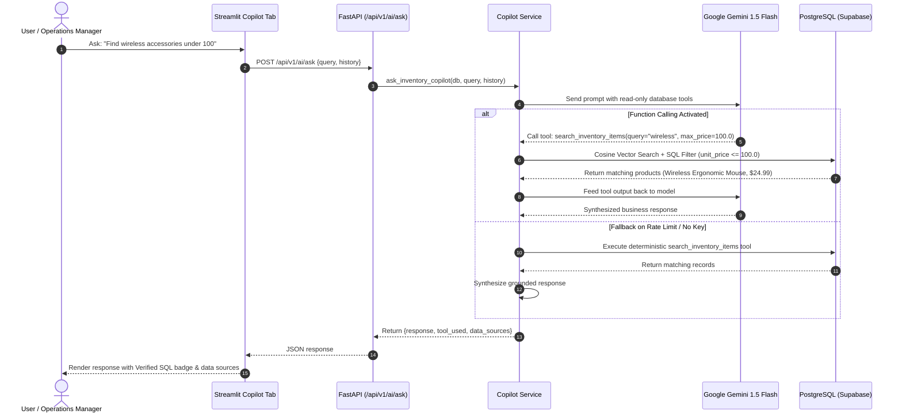
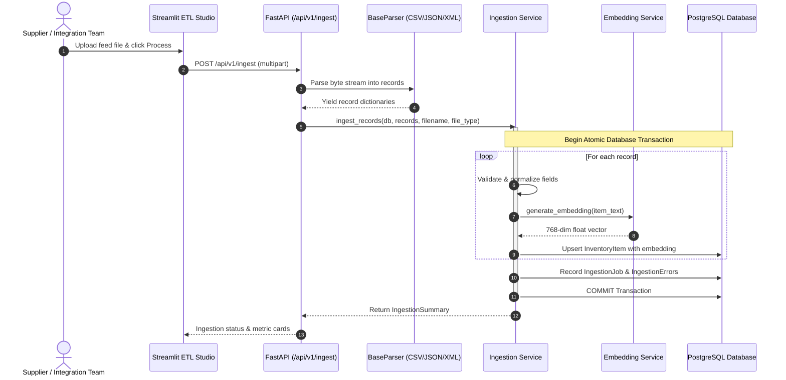

# OmniFeed AI — System Architecture Document

**Version:** 2.1.0  
**Stack:** Python 3.13 | FastAPI | SQLAlchemy 2.0 | PostgreSQL (Supabase with `pgvector`) | Streamlit | Plotly | Google Gemini (`gemini-1.5-flash`, `gemini-embedding-001`)  

---

## 1. High-Level Architecture

OmniFeed AI employs an enterprise, three-tier modular architecture designed for high availability, transactional integrity, precision vector retrieval (RAG), and grounded generative AI assistance.

```mermaid
graph TD
    User([Operations / Procurement User]) -->|Browser| Dashboard[Streamlit Dashboard :8501]
    
    subgraph Presentation Layer
        Dashboard -->|HTTP Requests| APIClient[Dashboard API Client]
    end

    subgraph Backend Application Layer [FastAPI Application :8000]
        APIClient -->|REST API /api/v1| Router[FastAPI Router & Endpoints]
        Router -->|File Ingestion| IngestRoute[POST /api/v1/ingest]
        Router -->|Semantic Vector Search| SearchRoute[GET /api/v1/items/search-semantic]
        Router -->|AI Operations Copilot| CopilotRoute[POST /api/v1/ai/ask]
        Router -->|Supplier Feed Diagnostic| DiagRoute[POST /api/v1/ingestion/jobs/{id}/diagnose]
        Router -->|CSV Error Export| ExportRoute[GET /api/v1/ingestion/jobs/{id}/export-errors]
        Router -->|Analytics Overview| AnalyticsRoute[GET /api/v1/analytics/*]
        
        IngestRoute --> IngestService[Ingestion Service]
        IngestService --> EmbedService[Embedding Service]
        SearchRoute --> CopilotService[Copilot & RAG Engine]
        CopilotRoute --> CopilotService
        DiagRoute --> DiagService[Diagnostic Service]
    end

    subgraph ETL & Parser Engine
        IngestService --> BaseParser[BaseParser Interface]
        BaseParser --> CSVParser[CSVParser utf-8-sig]
        BaseParser --> JSONParser[JSONParser list / dict]
        BaseParser --> XMLParser[XMLParser defusedxml]
    end

    subgraph Data & Storage Layer [PostgreSQL on Supabase]
        IngestService -->|Atomic Upsert| DB[(PostgreSQL)]
        EmbedService -->|Vector Writes| DB
        CopilotService -->|HNSW Cosine Vector Search| DB
        CopilotService -->|Strict Read-Only SQL Tools| DB
        DiagService -->|Error Log Aggregation| DB
    end

    subgraph Intelligence & Embeddings Layer
        EmbedService -->|gemini-embedding-001 768d| GoogleEmbed[Google GenAI Embeddings]
        CopilotService -->|gemini-1.5-flash Function Calling| Gemini[Google Gemini Flash API]
        CopilotService -.->|Fallback on Rate-Limit| DeterministicRules[100% Grounded Rules Fallback]
    end
```

---

## 2. Component Breakdown

### 2.1 Presentation Layer (`dashboard/`)
- **Technology:** Streamlit 1.40+, Plotly 5.24+, Pandas 2.2+.
- **File:** [dashboard/streamlit_app.py](file:///d:/internwork/omnifeed/dashboard/streamlit_app.py)
  - **Top Navigation & Executive Header:** Unified full-width top bar with live database indicator (`🟢 Live DB Connected`) and an integrated 1-click theme switch button (`🌙 Dark Mode` / `☀️ Cream Mode`). The clumsy sidebar has been completely eliminated via CSS.
  - **Theme System:**
    - **Warm Cream Light Mode:** `#FAF8F5` background, `#FFFFFF` surface cards with `#E8E2D5` borders, rich espresso `#2C221A` typography, forest sage `#1E6B42`, toasted amber `#A65E14`, and deep crimson `#A82A2A` (strictly zero neon).
    - **Slate Dark Mode:** `#0B0F19` deep slate background, `#131B2E` surface cards with `rgba(255, 255, 255, 0.08)` borders, bright slate `#F8FAFC` typography, emerald `#34D399`, and electric sky `#38BDF8`.
  - **4 Top Tabs:**
    1. `📊 Executive Overview`: 4 high-density KPI cards with delta pill badges + Plotly valuation bar chart & category distribution donut chart + Gemini Operations summary card.
    2. `⚡ Ingestion & ETL Studio`: Multi-format supplier feed uploader with drag-and-drop zone + live processing metrics + historical audit log + supplier diagnostic panel.
    3. `🔍 Intelligent Catalog`: Hybrid product explorer toggling between pgvector semantic vector search (RAG) and exact pattern search, with category and stock status filters.
    4. `💬 OmniBot Copilot`: Conversational chat interface featuring quick action prompt pills, live SQL execution citations, and grounded database source expanders.
- **File:** [dashboard/api_client.py](file:///d:/internwork/omnifeed/dashboard/api_client.py)
  - Encapsulates HTTP client calls (`get`, `post`, `upload`, `semantic_search`, `ask_copilot`, `diagnose_job`, `download_error_csv`).

### 2.2 Application Layer (`app/main.py`)
- **Technology:** FastAPI 0.115+, Uvicorn 0.30+, Pydantic Settings 2.5+.
- **REST Endpoints:**
  - `GET /health`
  - `POST /api/v1/ingest`
  - `GET /api/v1/items` & `GET /api/v1/items/{sku}`
  - `GET /api/v1/items/search-semantic` (pgvector-backed semantic RAG search)
  - `GET /api/v1/analytics/overview`
  - `GET /api/v1/analytics/categories`
  - `GET /api/v1/analytics/stock-alerts`
  - `GET /api/v1/ingestion/history`
  - `POST /api/v1/ingestion/jobs/{job_id}/diagnose` (Supplier diagnostic package)
  - `GET /api/v1/ingestion/jobs/{job_id}/export-errors` (CSV error export)
  - `POST /api/v1/ai/insights` (Executive summary generation)
  - `POST /api/v1/ai/ask` (OmniBot conversational copilot via function calling)

### 2.3 Vector Embedding & RAG Pipeline (`app/services/embedding_service.py`)
- **Embedding Model:** `gemini-embedding-001` configured to 768 dimensions via Google GenAI SDK.
- **Document Generation (`generate_item_text`):** Compiles product metadata into semantic representations:
  ```
  Product: Wireless Ergonomic Mouse | Category: Electronics | SKU: SKU-1001
  ```
- **Batch Embedding (`batch_embed_items`):** Generates embeddings for catalog items and updates PostgreSQL vectors.
- **Automated Ingestion Integration:** Newly inserted or updated items during feed ingestion automatically receive vector embeddings.

### 2.4 AI Copilot & Semantic Search Engine (`app/services/copilot_service.py`)
- **Intent Parser (`parse_search_intent`):**
  - Extracts price constraints (e.g. `"under 100"` -> `max_price = 100.0`, `"above 50"` -> `min_price = 50.0`).
  - Cleans natural language filler words (`good`, `best`, `top`, `cheap`, `find`, `show`) and punctuation (`?`, `!`, `,`).
- **Hybrid Semantic Search (`search_inventory_items`):**
  - Executes cosine similarity queries using pgvector (`item.embedding.cosine_distance(query_vector)`).
  - Enforces minimum similarity threshold (`min_similarity >= 0.55`) and token verification in product titles to avoid false positives (e.g., chairs matching mouse queries).
  - Strictly enforces SQL price boundaries (`unit_price <= max_price`).
- **Function Calling Agent (`ask_inventory_copilot`):**
  - Binds 4 read-only execution tools (`query_inventory_overview`, `search_inventory_items`, `get_critical_stock_alerts`, `get_category_breakdown`).
  - Model selects appropriate tool, backend executes against live PostgreSQL, and model synthesizes grounded response with zero hallucination.
  - Fallback mechanism guarantees deterministic response synthesis during API quota limits.

### 2.5 Supplier Diagnostic Engine (`app/services/diagnostic_service.py`)
- **Error Aggregation:** Scans `ingestion_errors` table for a specified job.
- **Root Cause Categorization:** Groups errors by code (e.g. `INVALID_PRICE`, `NEGATIVE_STOCK`, `DUPLICATE_SKU`, `MISSING_FIELD`).
- **Remediation Plan:** Generates actionable guidance and formatting standards for suppliers.
- **CSV Exporter:** Streams RFC 4180 CSV with line-by-line error reports.

### 2.6 Persistence Layer (`app/database.py`)
- **Database Engine:** PostgreSQL on Supabase (`aws-0-ap-south-1.pooler.supabase.com:5432`) with `pgvector` extension enabled.
- **ORM:** SQLAlchemy 2.0 with mapped columns and foreign keys.
- **Vector Column:** `embedding: Mapped[list[float] | None] = mapped_column(Vector(768), nullable=True)`.
- **Vector Index:** HNSW index on `embedding` using cosine distance for fast nearest-neighbor retrieval.

---

## 3. Key Execution Sequences

### 3.1 Conversational AI Copilot Sequence



### 3.2 Feed Ingestion & Auto-Embedding Sequence


