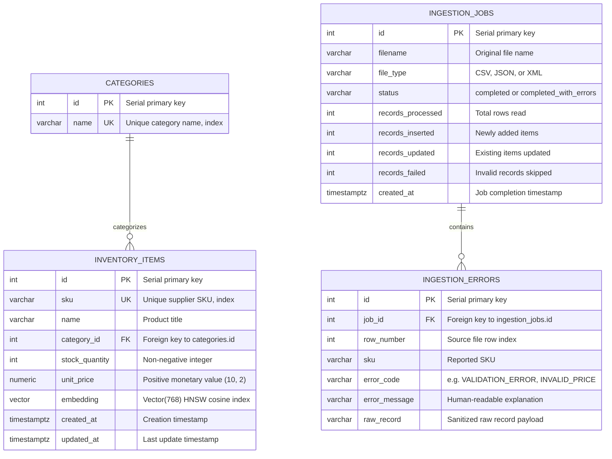
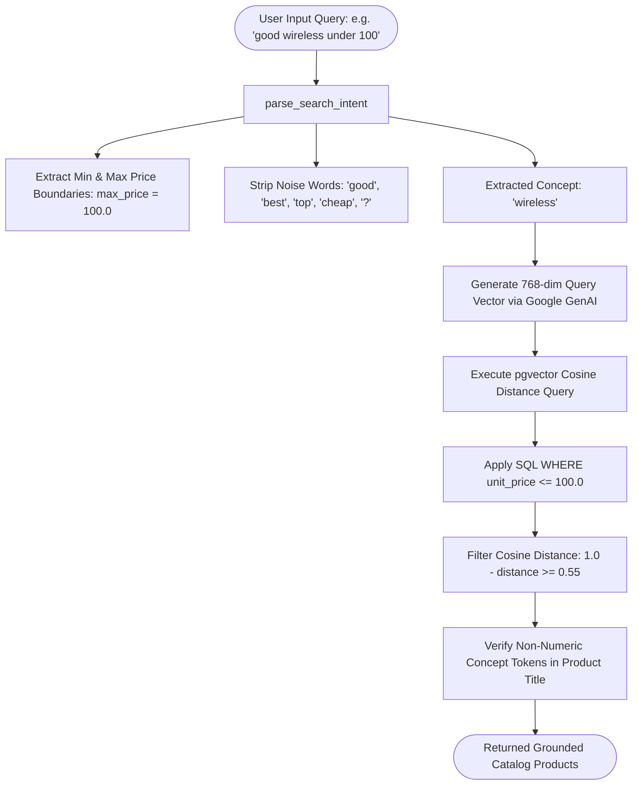

# OmniFeed AI — Technical Design Document

**Version:** 2.1.0  
**Focus:** Database Schema, Vector Indexing, AI Copilot Grounding, UI/UX Design System, Error Recovery  

---

## 1. Database Schema & Entity Relationships

The OmniFeed AI database design follows strict 3NF (Third Normal Form) normalization while isolating audit history from real-time catalog records and supporting high-dimensional vector embeddings via `pgvector`.

---

## 2. Table Specifications & Indexes

### 2.1 Table: `inventory_items`
| Column | Type | Constraints | Description |
| :--- | :--- | :--- | :--- |
| `id` | `SERIAL` | `PRIMARY KEY` | Unique item identifier |
| `sku` | `VARCHAR(64)` | `NOT NULL, UNIQUE, INDEX` | Unique product identifier code |
| `name` | `VARCHAR(255)` | `NOT NULL` | Product title / description |
| `category_id` | `INTEGER` | `REFERENCES categories(id) ON DELETE SET NULL, INDEX` | Category relationship |
| `stock_quantity` | `INTEGER` | `NOT NULL, CHECK (stock_quantity >= 0)` | Warehouse unit inventory count |
| `unit_price` | `NUMERIC(10, 2)` | `NOT NULL, CHECK (unit_price > 0)` | Base unit price in currency |
| `embedding` | `Vector(768)` | `NULLABLE` | Dense semantic vector embedding (`gemini-embedding-001`) |
| `created_at` | `TIMESTAMPTZ` | `DEFAULT NOW()` | Record insertion timestamp |
| `updated_at` | `TIMESTAMPTZ` | `DEFAULT NOW()` | Record modification timestamp |

**Indexes on `inventory_items`:**
- `uq_inventory_sku`: B-tree unique index on `sku`.
- `ix_inventory_items_category_id`: B-tree index on `category_id`.
- `ix_inventory_items_embedding_hnsw`: **HNSW vector index** using cosine distance (`vector_cosine_ops`) with parameters `m = 16`, `ef_construction = 64`.

---

## 3. Query Intent & Semantic Vector Search Flow

---

## 4. UI/UX Design System

The OmniFeed AI dashboard implements an **executive command center** interface adhering to modern SaaS design standards (Linear, Vercel, Stripe).

### 4.1 Design Tokens & Theming Matrix

| Design Token | Warm Cream Light Mode (Zero Neon) | Slate Dark Mode |
| :--- | :--- | :--- |
| **App Background** | `#FAF8F5` (Refined gallery cream) | `#0B0F19` (Deep obsidian slate) |
| **Surface Cards** | `#FFFFFF` (Crisp white surface) | `#131B2E` (Deep navy slate card) |
| **Card Borders** | `#E8E2D5` (Warm stone border) | `rgba(255, 255, 255, 0.08)` |
| **Primary Typography** | `#2C221A` (Espresso obsidian) | `#F8FAFC` (Bright slate white) |
| **Secondary Typography** | `#6E6459` (Muted warm taupe) | `#94A3B8` (Cool slate mist) |
| **Muted Metadata** | `#8A7E70` (Warm clay) | `#64748B` (Subtle grey) |
| **Accent / Focus** | `#9A5B2D` (Warm cognac / brass) | `#38BDF8` (Sky blue cyan) |
| **Delta Good** | `#1E6B42` (Forest sage green) | `#34D399` (Emerald green) |
| **Delta Warning** | `#A65E14` (Toasted warm amber) | `#FBBF24` (Amber gold) |
| **Delta Danger** | `#A82A2A` (Deep refined crimson) | `#F87171` (Coral rose) |
| **Chart Palette** | Earth tones: cognac, sage, bronze | Qualitative Prism / Teal gradients |

### 4.2 Top Navigation & Header Architecture
- **No Clumsy Sidebar:** The Streamlit sidebar is hidden (`display: none !important`), giving users a unified, full-screen SaaS command center.
- **Top Header Bar:**
  - Left: Brand logo icon `⚡`, title `OmniFeed AI`, tag `OPERATIONS HUB`, and live status badge (`🟢 Live DB Connected`).
  - Right: Instant 1-click theme switch button (`🌙 Dark Mode` / `☀️ Cream Mode`) with `on_click` callback.
  - Border separator line cleanly demarcating navigation from tab contents.

---

## 5. Failure Policy & Error Recovery Design

| Component | Failure Trigger | Recovery Action | User Experience Impact |
| :--- | :--- | :--- | :--- |
| **Ingestion Row Validation** | Invalid price, negative stock, missing SKU | Row caught, logged in `ingestion_errors`, batch proceeds | Remaining valid items are committed; error table lists row numbers. |
| **Duplicate SKU In-File** | Repeated SKU in single feed | In-memory set flags duplicate, row skipped | First occurrence is processed; subsequent occurrences logged. |
| **Vector Embedding API** | Quota limit or missing API key | Embedding set to `None`, warning logged | Item stored in database; keyword and exact search remain functional. |
| **Copilot GenAI Quota** | 429 Resource Exhausted / 503 Unavailable | Deterministic tool execution & synthesis fallback | Copilot returns verified database answer with zero downtime. |
| **Database Pool Timeout** | Transient Supabase latency | Pre-ping connection check and automatic reconnection | API endpoint retries without crashing the server. |
