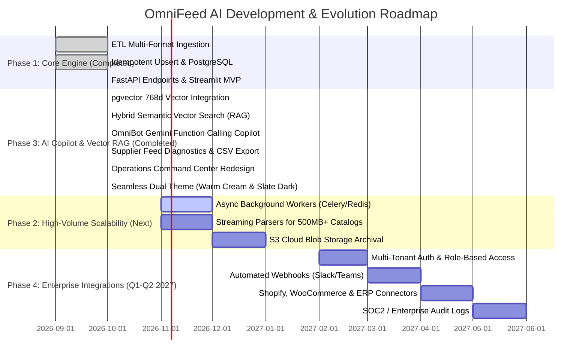

# OmniFeed AI — Product Roadmap

**Version:** 2.1.0  
**Current Milestone:** Phase 1 & Phase 3 (AI Intelligence & Vector RAG) Completed  
**Last Updated:** October 2026  

---

---

## Phase 1: Core Engine & Ingestion Pipeline *(Completed)*

- [x] Multi-format file parsing: CSV (`utf-8-sig`), JSON (top-level list & `"items"` dictionary), XML (`defusedxml`).
- [x] Data validation & price parsing: currency symbol stripping, decimal quantization, strict stock quantity verification.
- [x] Database architecture: PostgreSQL (Supabase pooler) with 3NF relational schema, unique SKU constraints, and foreign keys.
- [x] Transactional upsert engine: atomic transaction boundaries, intra-file duplicate SKU rejection, automatic category creation.
- [x] Complete REST API (FastAPI): health check, ingestion upload, catalog search & filtering, analytics aggregation.
- [x] Operations AI: Google Gemini 1.5 Flash integration with structured output and automatic deterministic rules fallback.

---

## Phase 3: AI Intelligence, Vector RAG & Copilot *(Completed)*

- [x] **pgvector Embeddings Integration:** 768-dimensional dense vector embeddings generated via `gemini-embedding-001` and stored in PostgreSQL with HNSW cosine distance indexing.
- [x] **Precision Hybrid Vector Search (RAG):** Fast semantic product lookups (`/api/v1/items/search-semantic`) with query intent parsing (`parse_search_intent`), price bound filtering (`under 100` -> `unit_price <= 100.0`), cosine similarity thresholds (`min_similarity >= 0.55`), and token filtering.
- [x] **OmniBot Operations Copilot:** Grounded conversational agent (`/api/v1/ai/ask`) powered by Gemini Function Calling bound to read-only database tools with 100% database grounding fallback.
- [x] **Supplier Quality Diagnostics & Remediation:** Automated root-cause error analysis and remediation packages (`/diagnose`) with downloadable CSV error reports (`/export-errors`).
- [x] **Executive Operations Command Center:** 4-tab Streamlit dashboard with KPI metric tiles, Plotly charts, top navbar, and an integrated 1-click theme switch supporting **Warm Cream Light Mode** (`#FAF8F5`, zero neon) and **Slate Dark Mode** (`#0B0F19`).
- [x] **Comprehensive Test Suite:** 57 automated pytest tests passing with 100% success rate across parsers, services, RAG, and API routes.

---

## Phase 2: High-Volume Scalability & Async Ingestion *(Next Milestone: Q4 2026)*

- [ ] **Asynchronous Task Queue:** Integrate Celery + Redis for processing files > 10MB asynchronously in background worker pools.
- [ ] **Streaming Parsers:** Implement `ijson` for incremental JSON parsing and `lxml.etree.iterparse` with memory clearing for large XML files up to 500MB.
- [ ] **Cloud Storage Archival:** Integrate AWS S3 / Google Cloud Storage for permanent storage of raw supplier catalog uploads with signed download URLs.
- [ ] **Batch Database Inserts:** Utilize PostgreSQL `execute_values` or bulk upserts to achieve 15,000 records/sec throughput.

---

## Phase 4: Enterprise & Ecosystem Integrations *(Q1-Q2 2027)*

- [ ] **Multi-Tenant Security:** Organization and team tenancy with JWT/OAuth2 authentication and role-based access control (Admin, Manager, Read-Only).
- [ ] **Automated Webhooks:** Webhook triggers on stock-out events sent to Slack, Microsoft Teams, and email.
- [ ] **E-commerce & ERP Connectors:** Native two-way synchronization with Shopify, WooCommerce, SAP, and NetSuite.
- [ ] **Comprehensive Audit Logs:** SOC2-compliant immutable logging of all catalog modifications, file uploads, and price overrides.
